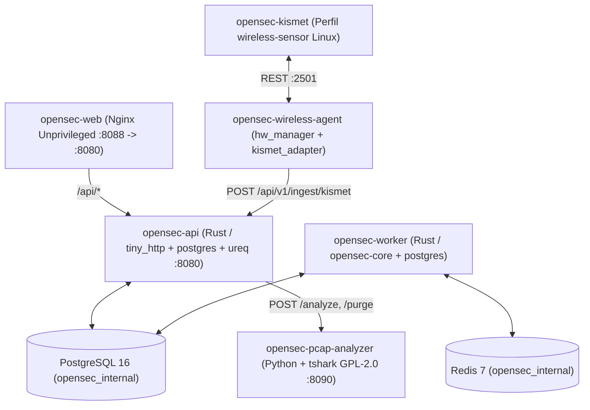

# ARQUITECTURA_OPENSEC.md — Ingeniería Inversa y Arquitectura Integral

**Repositorio:** `https://github.com/saghet/opensec-studio`  
**Nota de transparencia (Fase 1):** No existen registros internos de prompts o decisiones previas de generación; esta arquitectura se reconstruye directamente a partir de los archivos, commits (`v1.10.10` → `main`), manifiestos y código fuente del repositorio.

---

## 1. Dos Capas Históricas del Repositorio

1. **Capa de Distribución Clásica (`v1.10.10`):**
   - El repositorio público original contenía únicamente los instaladores referenciados en GitHub Releases (`Instalador_OpenSec_Studio_Setup.exe`, `Instalador_Empresarial_OpenSec_Studio.msi`), manuales multilingües de 19 capítulos (`manuales/`), landing page (`docs/`, `landing-page/`), marketing (`marketing/`) y manifiestos Windows (`winget`, `scoop`, `chocolatey`). El código fuente de escritorio Tauri original **no reside en este repositorio público**.
2. **Plataforma Wireless Security (Docker + Rust + Python):**
   - Implementada en `crates/opensec-core`, `services/{opensec-api,opensec-worker,opensec-pcap-analyzer,opensec-web,opensec-wireless-agent}`, `docker/` y `scripts/`.

---

## 2. Arquitectura Modular de 3 Planos

---

## 3. Tecnologías, Dependencias y Comunicación

- **Lenguajes:** Rust (`edition = "2021"`, `crates/opensec-core`, `opensec-api`, `opensec-worker`), Python 3 (`opensec-pcap-analyzer`, `opensec-wireless-agent`), HTML/CSS/JS vanilla (`opensec-web`), SQL (PostgreSQL 16).
- **Crates Rust principales:** `postgres 0.19` (`with-serde_json-1`), `serde` / `serde_json`, `tiny_http 0.12`, `ureq 2.12`.
- **Herramientas externas aisladas por proceso:** `tshark` (Wireshark GPL-2.0 en `opensec-pcap-analyzer`), `kismet` (GPL-2.0 en `opensec-kismet`), `iw`/`ethtool` en `opensec-wireless-agent`.
- **Compilación y distribución:**
  - Desarrollo/Producción: `docker compose -f docker-compose.yml -f docker-compose.{dev,prod}.yml up -d --build`.
  - Actualización: `scripts/update.sh` (backup previo + rebuild).
  - Lanzador Windows: `scripts/launch-opensec.ps1` + acceso directo en Escritorio.
