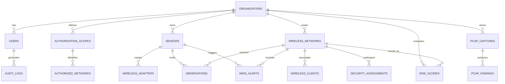

# DATA_MODEL.md — Modelo de Datos Normalizado (FASE 1)

**Proyecto:** OpenSec Studio — Wireless Security Platform  
**Motor principal:** PostgreSQL 16+ (persistencia transaccional y analítica) + Redis 7+ (Streams de telemetría y caché de estado).

---

## 1. Diagrama Entidad-Relación (ER)

---

## 2. Catálogo de Entidades Principales

### A. Control Plane, Autorización y Gobernanza (Regla 13)

1. **`organizations`**: `id (UUID PK)`, `name`, `slug`, `retention_days_pcap (INT, default 7)`, `retention_days_telemetry (INT, default 90)`, `created_at`.
2. **`users`**: `id (UUID PK)`, `org_id (FK)`, `email`, `password_hash (Argon2id)`, `role (ENUM: admin, analyst, auditor, viewer)`, `is_active`, `created_at`.
3. **`authorization_scopes`**: `id (UUID PK)`, `org_id (FK)`, `name`, `mode (ENUM: passive_only)`, `kill_switch_active (BOOL, default false)`, `approved_by (FK users)`, `valid_from`, `valid_until`, `evidence_ref`.
4. **`authorized_networks`**: `id (UUID PK)`, `scope_id (FK)`, `ssid_pattern`, `bssid (MAC, nullable)`, `band_filter`, `notes`.
5. **`audit_logs`**: `id (BIGSERIAL PK)`, `org_id (FK)`, `user_id (FK)`, `action`, `resource_type`, `resource_id`, `metadata (JSONB)`, `created_at` *(append-only)*.

### B. Sensores y Hardware Wi-Fi (Regla 4)

6. **`sensors`**: `id (UUID PK)`, `org_id (FK)`, `hostname`, `deployment_mode (ENUM: docker, native_systemd)`, `status (ENUM: online, offline, degraded, killed)`, `last_heartbeat_at`, `kismet_endpoint`.
7. **`wireless_adapters`**: `id (UUID PK)`, `sensor_id (FK)`, `interface_name`, `mac_address`, `vendor`, `chipset`, `driver`, `firmware_version`, `supports_monitor_mode (BOOL)`, `supported_bands (TEXT[])`, `available_channels (INT[])`, `reg_domain`, `limitations (JSONB)`, `probed_at`.

### C. Inventario Wi-Fi y Telemetría (Reglas 5, 7, 10)

8. **`wireless_networks`**: `id (UUID PK)`, `org_id (FK)`, `bssid (MAC)`, `ssid`, `oui_vendor`, `band (ENUM: 2.4GHz, 5GHz, 6GHz)`, `channel (INT)`, `security_observed (TEXT)`, `pmf_status (ENUM: required, capable, disabled, unknown)`, `wps_observed (BOOL)`, `is_authorized (BOOL)`, `first_seen_at`, `last_seen_at`. *(Índice único: `(org_id, bssid, ssid)`).*
9. **`wireless_clients`**: `id (UUID PK)`, `org_id (FK)`, `client_mac (MAC)`, `oui_vendor`, `associated_network_id (FK, nullable)`, `randomized_mac_suspected (BOOL)`, `first_seen_at`, `last_seen_at`.
10. **`observations`**: `id (BIGSERIAL PK)`, `org_id (FK)`, `sensor_id (FK)`, `network_id (FK)`, `source_engine (ENUM: kismet, airgorah_adapter, pcap)`, `rssi_dbm (INT)`, `channel (INT)`, `noise_dbm (INT, nullable)`, `beacon_interval_ms (INT, nullable)`, `raw_ies_hash (TEXT)`, `observed_at (TIMESTAMPTZ)`. *(Particionada por `observed_at` para retención eficiente).*

### D. Análisis PCAP (Regla 7)

11. **`pcap_captures`**: `id (UUID PK)`, `org_id (FK)`, `sensor_id (FK, nullable)`, `filename`, `sha256`, `size_bytes`, `packet_count`, `capture_start`, `capture_end`, `encrypted_storage_path`, `expires_at (TIMESTAMPTZ)`, `status (ENUM: pending, analyzed, purged)`.
12. **`pcap_findings`**: `id (UUID PK)`, `capture_id (FK)`, `network_id (FK, nullable)`, `protocol`, `indicator_type`, `severity`, `summary`, `technical_details (JSONB)`, `created_at`.

### E. Evaluación, WIDS y Risk Engine (Reglas 8, 9, 11)

13. **`security_assessments`**: `id (UUID PK)`, `org_id (FK)`, `network_id (FK)`, `assessment_type`, `finding_nature (ENUM: observed_config, inferred_config, proven_vulnerability, potential_risk)`, `severity (ENUM: critical, high, medium, low, info)`, `confidence (NUMERIC 0..1)`, `title`, `explanation`, `remediation`, `evidence (JSONB)`, `detected_at`, `resolved_at`.
14. **`wids_alerts`**: `id (UUID PK)`, `org_id (FK)`, `sensor_id (FK)`, `network_id (FK, nullable)`, `rule_id`, `category (ENUM: rogue_ap, evil_twin_suspect, ssid_duplicate, mac_change, encryption_downgrade, beacon_flood, deauth_storm, channel_anomaly, unknown_ap)`, `severity`, `confidence (NUMERIC 0..1)`, `dedup_key (TEXT)`, `explanation`, `evidence (JSONB)`, `first_triggered_at`, `last_triggered_at`, `status (ENUM: open, acknowledged, false_positive, resolved)`.
15. **`risk_scores`**: `id (UUID PK)`, `org_id (FK)`, `network_id (FK)`, `score (NUMERIC 0..100)`, `factors (JSONB: severity, confidence, impact, exposure, criticality, auth_config, age, repetition)`, `explanation`, `mitigation_summary`, `calculated_at`.

---

## 3. Flujo de Normalización y Deduplicación

1. **Ingesta:** `Kismet`, `PCAP Analyzer` y `RF Engine` publican eventos JSON en `Redis Streams` (`opensec:raw_observations`).
2. **Normalización:** El servicio `Normalizer` mapea los campos heterogéneos al esquema canónico (`Observation`, `NetworkSnapshot`) y verifica `ScopeGuard` (si `kill_switch_active = true`, descarta la captura activa y registra evento en `audit_logs`).
3. **Correlación y Deduplicación:**
   - Las alertas WIDS usan `dedup_key = hash(org_id, rule_id, bssid, window_bucket)` para incrementar `last_triggered_at` y acumular evidencias en lugar de generar filas duplicadas.
   - Los hallazgos de evaluación distinguen explícitamente entre `observed_config`, `inferred_config`, `proven_vulnerability` y `potential_risk` (Regla 8).
