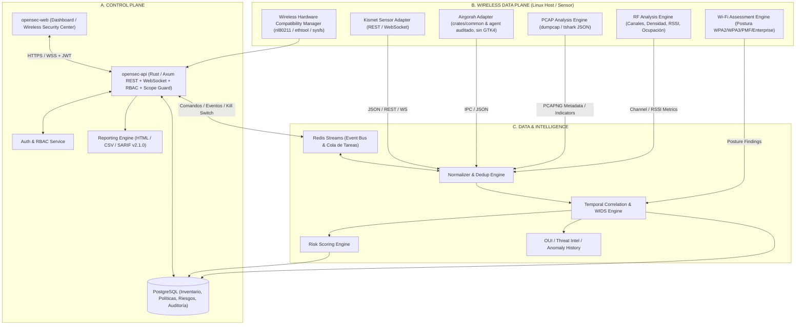

# WIRELESS_ARCHITECTURE.md — Arquitectura Objetivo (FASE 1)

**Proyecto:** OpenSec Studio — Wireless Security Platform  
**Versión de diseño:** 1.0 (FASE 1)  
**Modo operativo por defecto:** Pasivo / Observación autorizada (sin capacidades ofensivas).

---

## 1. Principios Rectores de Arquitectura

1. **Separación en 3 planos independientes:** Control Plane, Wireless Data Plane y Data & Intelligence.
2. **Desacoplamiento Frontend ↔ Captura:** El dashboard (`opensec-web`) nunca accede directamente a interfaces de red, sockets `AF_PACKET` ni procesos de captura; toda interacción pasa por `opensec-api`.
3. **Agnosticismo de despliegue (Docker ↔ Linux Nativo):** Los motores Rust/Python/C++ no dependen de la API de Docker ni de variables exclusivas de contenedores. Se comunican mediante interfaces estándar (HTTP/REST, WebSocket, Unix Domain Sockets o Redis Streams) y adaptadores de ciclo de vida (`RuntimeAdapter`: `DockerAdapter` / `SystemdAdapter`).
4. **Aislamiento de licencias (Regla 16):** Componentes GPL-2.0 (`kismet`, `tshark`/`dumpcap`) se ejecutan como procesos/contenedores independientes comunicados vía REST/JSON/PCAPNG, evitando contaminación copyleft sobre el Core de OpenSec.
5. **Seguridad y autorización por diseño (Regla 13):** Scope explícito por organización, allowlist de BSSID/SSID, RBAC, auditoría inmutable y Kill Switch global por sensor/evaluación.

---

## 2. Arquitectura de Tres Niveles

---

## 3. Contratos e Interfaces entre Motores

Cada motor implementa una interfaz desacoplada y documentada:

| Motor / Adaptador | Protocolo / Interfaz | Entrada | Salida normalizada |
| :--- | :--- | :--- | :--- |
| **Wireless Hardware Manager** | CLI/Daemon local (`nl80211`, `/sys/class/net`, `iw`) → JSON vía gRPC/HTTP o UDS | `list_adapters()`, `probe_capabilities(iface)` | `AdapterCapabilityReport` (chipset, driver, firmware, bandas, monitor mode) |
| **Kismet Sensor Adapter** | HTTP REST + WebSocket (`/devices/views/...`, `/alerts/...`) | `SensorConfig` + `ScopeFilter` | `NormalizedObservation`, `DeviceStateChange`, `KismetAlert` |
| **Airgorah Adapter** | Subproceso/IPC usando `airgorah-common` (sin `crates/gui` GTK4) | `PassiveScanRequest` (filtrado por `ScopeGuard`) | `DiscoveredAP`, `ClientObservation` |
| **PCAP Analysis Engine** | Wrapper controlado sobre `tshark -T ek` / `-T json` + `capinfos` | Ruta PCAP/PCAPNG autorizada + `RetentionPolicy` | `PcapSummary`, `ProtocolBreakdown`, `AnomalyIndicator` |
| **Wi-Fi Assessment Engine** | Crate Rust interno (`opensec-assess`) | `ObservedNetworkSnapshot` + `PcapIndicators` | `SecurityFinding` (`observed` vs `inferred` vs `proven`) |
| **Wireless IDS (WIDS) Engine** | Consumidor de Redis Streams (`opensec:observations`) | Ventana temporal de observaciones multi-sensor | `WidsAlert` (confianza, severidad, evidencias, explicación) |
| **RF Analysis Engine** | Consumidor de métricas de canal/RSSI | Serie temporal de beacons/probes por canal/banda | `ChannelOccupancyReport`, `BandDistribution` |
| **Risk Engine** | Servicio Rust interno (`opensec-risk`) | `SecurityFinding` + `WidsAlert` + criticidad de red | `RiskScore` deduplicado + recomendaciones de mitigación |

---

## 4. Evaluación Técnica Inicial de Proyectos de Referencia

| Proyecto | Versión / Tag | Licencia | Lenguaje | Qué se aprovecha | Qué se aísla / descarta |
| :--- | :--- | :--- | :--- | :--- | :--- |
| **Kismet** (`kismetwireless/kismet`) | `kismet-2026-10-R1` | GPL-2.0 (verificación en curso) | C++ | Captura pasiva multi-fuente, inventario SSID/BSSID/clientes, OUI, alertas base, exportación REST/WS/pcapng. | Se ejecuta como servicio/contenedor separado; no se enlaza como librería C++ dentro de OpenSec. |
| **Wireshark** (`wireshark/wireshark`) | `wireshark-4.4.9` | GPL-2.0 | C | `tshark`, `dumpcap`, `capinfos` y dissectors IEEE 802.11 / Radiotap para análisis profundo de PCAP/PCAPNG. | No se enlaza `libwireshark` en el binario Rust; se invoca `tshark`/`dumpcap` aislado por proceso. |
| **Airgorah** (`martin-olivier/airgorah`) | `v0.9.0` | MIT | Rust (`edition 2024`) | Workspace modular (`crates/common`, `crates/agent`, `crates/gui`). Modelos serializables en `airgorah-common` y patrones de integración con adaptadores Linux. | Se descarta `crates/gui` (GTK4) y cualquier flujo ofensivo de desautenticación/inyección/cracking. |
| **SentinelWiFi** (`navairgap/SentinelWiFi`) | `v2.1.0` | MIT | Python | Enfoque estrictamente defensivo/pasivo, heurísticas de auditoría de entorno Wi-Fi y estructura de reportes defensivos. | Se evalúa como referencia de reglas defensivas y pruebas; el motor principal de producción se implementa en Rust. |

---

## 5. Preparación para Docker (FASE 2) y Linux Nativo (FASE 10)

Para garantizar la portabilidad total entre Docker y una futura distribución Linux nativa (`systemd` + `.deb`/`.rpm`/`AppImage`):

- **Configuración 100% por variables de entorno / archivos TOML** (`/etc/opensec/` en nativo o montados en Docker), sin rutas hardcodeadas.
- **Acceso al hardware Wi-Fi desacoplado:** El `opensec-wireless-agent` corre en el plano de sensor Linux (`network_mode: host` + `NET_ADMIN`/`NET_RAW` en Docker, o servicio `systemd` con `AmbientCapabilities=CAP_NET_ADMIN CAP_NET_RAW` en Linux nativo).
- **Kill Switch inmediato:** Cualquier revocación de scope o activación del Kill Switch envía una señal de parada al `SensorAdapter` en `< 1s` y detiene la ingesta en el bus de eventos.
